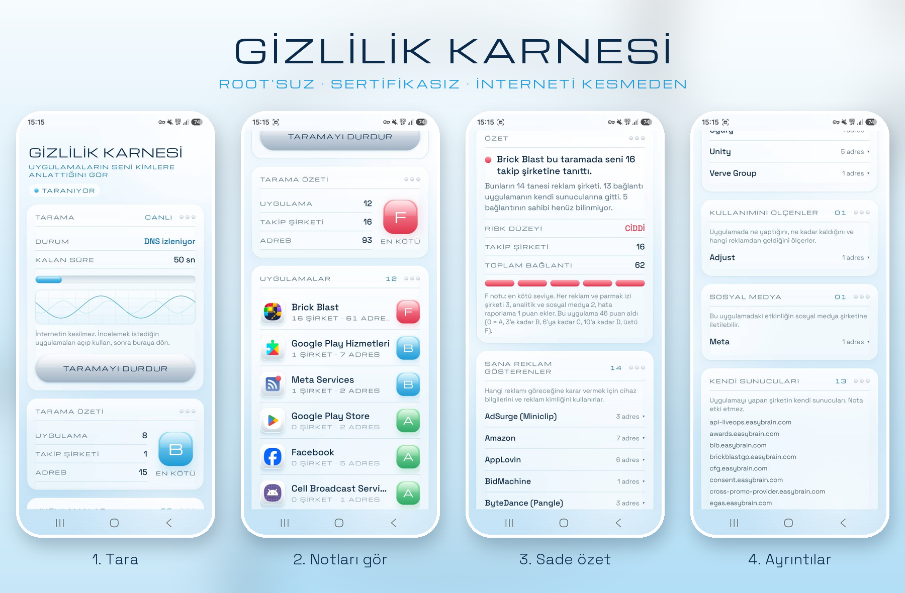

# Gizlilik Karnesi

**Telefonundaki uygulamalar seni hangi reklam ve analitik şirketlerine anlatıyor?**

Gizlilik Karnesi, Android uygulamalarının arka planda hangi takip (tracker) şirketlerine bağlandığını tespit eden ve her uygulamaya **A'dan F'ye bir gizlilik notu** veren bir Android uygulamasıdır. **Root gerektirmez, telefona sertifika kurmaz ve tarama sırasında interneti kesmez.**

> 🚧 **Geliştirme aşamasında.** Temel özellikler çalışıyor; yeni özellikler eklenmeye devam ediyor.

<p align="center">
  
</p>

<p align="center"><i>Gerçek telefonda (Samsung Galaxy S23, Android 16) yapılan bir tarama: Brick Blast oyunu 60 saniyede 16 takip şirketine bağlandı ve F notu aldı.</i></p>

## Ne yapar?

- **Hangi uygulama, hangi şirkete bağlanıyor?** Tarama süresince uygulamaların yaptığı DNS sorgularını yakalar ve her sorguyu onu yapan uygulamaya atar.
- **Takip şirketlerini tanır.** 122 alan adından oluşan bir listeyle eşleştirme yapar (Google, Meta, AppLovin, Unity, Pangle, Moloco, Mintegral, Criteo...). Her şirketi amacına göre sınıflandırır: reklam, parmak izi, analitik, sosyal medya, hata raporlama.
- **A-F notu verir.** Puan alan adı başına değil, **şirket başına** hesaplanır: reklam ve parmak izi şirketleri 3, analitik ve sosyal medya 2, hata raporlama 1 puandır. 0 puan A, 3'e kadar B, 6'ya kadar C, 10'a kadar D, üstü F'dir.
- **Bağlantıları ayırır.** Her adres tek bir gruba girer:
  - takip şirketi,
  - uygulamanın **kendi sunucusu** (ör. Brick Blast için `easybrain.com`),
  - **bulut altyapısı** (CDN, bulut depolama),
  - tanımlanamayan.

  Not yalnızca takip şirketlerinden hesaplanır.
- **Sade Türkçe anlatır.** Örnek: *"Brick Blast bu taramada seni 16 takip şirketine tanıttı. Bunların 14 tanesi reklam şirketi. 13 bağlantı uygulamanın kendi sunucularına gitti."* Şirketler "Sana reklam gösterenler", "Kullanımını ölçenler" gibi amaç gruplarında gösterilir.
- **Sonuçları saklar ve dışa aktarır.** Her tarama telefonda kaydedilir. Sonuçlar CSV olarak paylaşılabilir; her satır bir uygulamanın bağlandığı bir adrestir.

## Nasıl çalışır?

```
 Uygulamalar ──DNS sorgusu──▶ [ Sanal DNS 10.0.0.53 ]  ◀── yalnızca bu adres VPN tüneline girer
                                     │
                   1) Sorgunun sahibini bul (getConnectionOwnerUid → paket adı)
                   2) Sorguyu gerçek DNS'e ilet, cevabı uygulamaya geri yaz
                   3) Alan adını tracker listesiyle eşleştir → not hesapla
                                     │
 Diğer tüm trafik ───────────────────┴──▶ normal yoldan gider (internet kesilmez)
```

- **Sadece DNS'i yakalayan VPN:** `VpnService` yalnızca sanal DNS adresini (`/32`) tünele yönlendirir. Web, video ve oyun trafiği tünele girmez; bu yüzden tarama sırasında internet yavaşlamaz.
- **DNS iletici:** Sorgular korunan (`protect`) tek bir UDP soketiyle gerçek DNS sunucularına iletilir. Aynı anda gelen aynı sorgular birleştirilir, cevaplar 30 saniye önbellekte tutulur, cevap gelmezse yedek sunucular denenir. Cevap paketi IPv4/UDP olarak elle oluşturulur (RFC 1071 sağlama toplamı).
- **Uygulama atama:** Sorgunun sahibi, sorgu iletilmeden **önce** bulunur. Ters sırada yapıldığında hızlı dönen cevaplar yüzünden bağlantı kapanıyor ve sorgular "bilinmeyen"e düşüyordu. Emülatördeki testte 1303 sorgunun tamamı doğru uygulamaya atandı.

## Sınırlılıklar

- **Şifreli içerik okunmaz.** Uygulama, verinin *nereye* gittiğini görür, *içinde ne olduğunu* görmez. Root ve sertifika gerektirmemenin bilinçli bedeli budur.
- **Yalnızca DNS'e bakar.** Uygulama içi şifreli DNS (DoH), sabit IP adresleri veya önbellekten tekrar kullanılan adresler görünmeyebilir.
- **Takip listesi elle derlenmiştir** ve her şirketi kapsamaz. Tanınmayan adresler "Tanımlanamayanlar" altında ayrıca gösterilir.
- **Tarayıcılarda** bağlantıların çoğu ziyaret edilen web sitelerinden gelir; uygulama bunu özette ayrıca belirtir.

## Derleme ve çalıştırma

Gereksinimler: Android Studio, Android 10 (API 29) veya üstü bir cihaz ya da emülatör.

```bash
./gradlew assembleDebug        # APK: app/build/outputs/apk/debug/app-debug.apk
./gradlew testDebugUnitTest    # birim testleri
```

Kullanım: **TARAMAYI BAŞLAT**'a bas, VPN iznini onayla, incelemek istediğin uygulamaları 60 saniye içinde kullan, sonra Gizlilik Karnesi'ne dön.

## Proje yapısı

```
app/src/main/java/com/example/gizlilikarnesi/
├── capture/     VPN servisi, DNS iletici, paket ayrıştırma, uygulama atama
├── analysis/    tracker veritabanı, notlama, kendi sunucusu tespiti, sade özet, CSV
├── data/        taramaların kalıcı kaydı ve dışa aktarma
└── ui/          Jetpack Compose ekranları ve Aero tasarım bileşenleri
app/src/main/assets/trackers.json   takip şirketi ve altyapı listesi
```

Teknolojiler: Kotlin, Jetpack Compose, Material 3, Coroutines. Ek bir ağ kütüphanesi kullanılmaz.

## Üçüncü taraf kaynaklar

- **Fontlar:** [Michroma](https://github.com/googlefonts/Michroma-font) ve [Space Grotesk](https://github.com/floriankarsten/space-grotesk), SIL Open Font License 1.1. Lisans metinleri [`licenses/`](licenses/) klasöründedir.
- **Takip şirketi kategorileri:** [DuckDuckGo Tracker Radar](https://github.com/duckduckgo/tracker-radar) (CC BY-NC-SA 4.0) ve [Exodus Privacy](https://reports.exodus-privacy.eu.org/) (ODbL) kaynaklarından yararlanılarak elle derlenmiştir. Gerçek cihaz taramalarında görülen bazı reklam ağları ayrıca eklenmiştir.

## Lisans

Henüz bir açık kaynak lisansı seçilmedi; kod tüm hakları saklı olarak paylaşılmaktadır.
